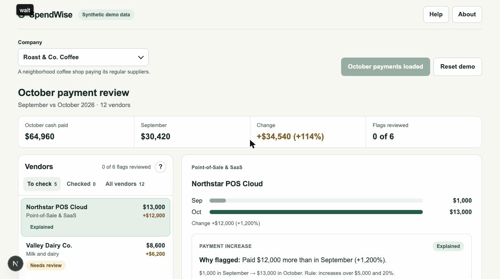

# SpendWise AI

**AI-assisted vendor payment exception review — deterministic financial math, scoped evidence retrieval, and human-in-the-loop review.**

Built by **Elliot Watson & Jian Ting Li** · **Live demo:** [spendwise-olive-theta.vercel.app](https://spendwise-olive-theta.vercel.app) *(public read-only view; GitHub sign-in required to run or reset investigations)*



---

## 30-Second Overview

When reviewing monthly vendor payments, finance analysts have to cross-check payment runs against invoices and FP&A notes to tell whether an unusual outflow is a possible duplicate payment or an expected contract change.

**SpendWise AI** pairs **deterministic application rules** with **one read-only Claude investigator**:

1. **Application code** calculates net cash paid (integer USD cents, entry-date cash basis, explicit reversals) and flags payment increases (`≥ $5,000` and `≥ 20%`) and possible duplicate payments (`same vendor & amount within 7 days`).
2. **Claude (`claude-opus-5-5`)** investigates each exception through 4 scoped, read-only tools (`get_payment_summary`, `list_payments`, `get_invoices`, `get_vendor_notes`) under strict runtime budgets (`≤ 8` tool calls, `≤ 10` model calls, `60s` timeout).
3. **Application validation** checks every cited ID, screens for overclaims or unsupported dollar figures, and only marks a finding **`Explained`** when the cited invoices and notes mathematically cover the cash change.
4. **A finance analyst** inspects the linked source records and records human acknowledgment (**Mark reviewed** — acknowledgment only, never payment approval or autonomous execution).

---

## Demo Scenarios — *Roast & Co. Coffee* (October 2026 Close)

| Vendor | Sep → Oct Cash | What Triggered It | Scenario Evidence & Expected Pattern |
| --- | --- | --- | --- |
| **Northstar POS Cloud** *(Point-of-Sale & SaaS)* | `$1,000` → `$13,000` (`+1,200.0%`) | `$12,000` increase (`≥ $5,000` & `20%`) | **Example `Explained` pattern** — `$1,000` monthly terminal usage billed on Oct 15, plus a `$12,000` annual enterprise platform subscription (`Invoice NS-2026`, `note-renewal`) covering Oct 2026–Sep 2027. |
| **Harbor Tax & Advisory** *(Quarterly Tax & Audit)* | `$0` → `$6,000` | Two `$3,000` payments 2 days apart + `$6,000` increase | **Example `Needs Review` pattern** — Two `$3,000` payments (`Oct 8` & `Oct 10`) reference the **same** `$3,000` Q3 sales-tax invoice (`HA-101`). Flags **`$3,000.00` in question, not confirmed**. |
| **Fieldwork Creative Studio** *(Packaging & Store Design)* | `$0` → `$3,000` | Two `$1,500` payments 2 days apart | **Lookalike pattern (`Explained` in baseline; `Needs Review` when cautiously hedged)** — `pay-design-a` pays `Invoice FS-201` (*holiday coffee bag artwork*) and `pay-design-b` pays `Invoice FS-202` (*winter cafe menu boards*). |

*Note on live vs. local outcomes:* The table and walkthrough above illustrate the underlying scenario evidence. In live `claude-opus-5-5` runs, verified `Explained` counts vary with model phrasing (2, 1, and 2 verified explanations across three consecutive live runs in [DEMO-01](worklog/jian/DEMO-01.md)). Local `stub` mode returns unverified placeholder drafts without calling the model.

---

## Why It's Production-Minded

- **Zero LLM math:** All currency math uses safe integer cents in application code; the model never computes totals or modifies records.
- **Evidence verification over prompt trust:** Valid record IDs alone cannot produce a verified finding. Application code verifies invoice balance, note consistency, and overclaim rules before any `Explained` badge is shown.
- **Prompt-injection & budget safety:** Retrieved vendor notes are wrapped as untrusted data (`≤ 4,000` chars), and SDK retries are locked to `0` under hard per-run budgets.
- **Idempotent demo & generation safety:** Resetting increments the database generation atomically inside a transaction so in-flight runs can never overwrite a fresh reset.

---

## Evaluation Results (`claude-opus-5-5` vs. Rule-Based Baseline)

Evaluated across **13 synthetic cases** (9 development + 4 held-out, [decision 004](docs/decisions/004-evaluation.md)) and verified across 3 consecutive end-to-end live cycles ([DEMO-01 worklog](worklog/jian/DEMO-01.md)):

| Metric | Claude (Dev, 9) | Baseline (Dev) | Claude (Held-out, 4) | Baseline (Held-out) |
| --- | --- | --- | --- | --- |
| Unsupported `Explained` findings | **0** | 0 | **0** | 0 |
| Acceptable label after validation | **9 / 9** | 9 / 9 | **3 / 4** | 4 / 4 |
| Required evidence cited | **18 / 18** | 18 / 18 | **11 / 11** | 11 / 11 |
| Causes correct (human review) | **8 correct, 1 partly** | Not human-scored | **4 / 4** | Not human-scored |

*Note:* The single held-out label miss came from the validator rejecting a correct, cautiously worded answer on the lookalike case. The baseline matched or exceeded Claude's automatic label scores where its record checks passed, while analyst review time and relative usefulness of model-written next steps remain unmeasured ([decision 004](docs/decisions/004-evaluation.md)).

---

## Tech Stack & Local Quickstart

**Stack:** Next.js 16 (App Router, Node Route Handlers) · React 19 · TypeScript · Zod · Claude (`@anthropic-ai/sdk`) · Neon Postgres (`pg`) & local PGlite · Auth.js (GitHub OAuth) · Vitest · Playwright

```sh
nvm use
npm ci
cp .env.example .env.local
npm run dev
```

Open **http://127.0.0.1:3000** (runs offline out of the box with local PGlite and stub mode; no API keys required).

[Developer setup](docs/development.md) · [Product requirements](docs/prd.md) · [Architecture decisions](docs/decisions/) · [Working agreement](AGENTS.md)
