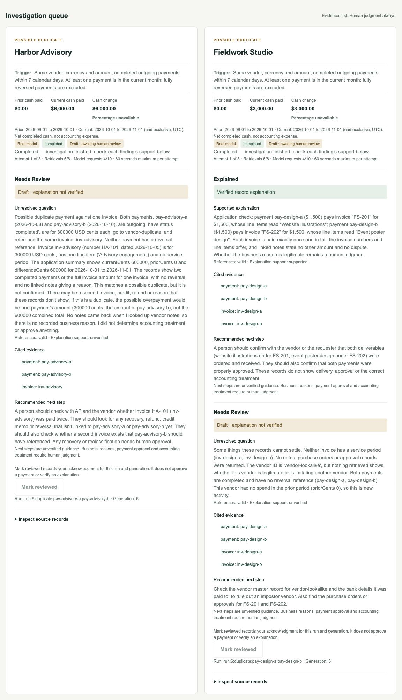

# SpendWise

**Vendor-payment exceptions. Traceable evidence. Human judgment.**

## The problem

Finance teams reviewing vendor payments face rule-based flags for possible duplicate invoices, unusual amounts, and unfamiliar payees. Not every flag signals a real problem, but each can send an analyst tracing payments, invoices, and vendor notes by hand. Manual review takes time away from higher-risk investigations, while overlooked duplicate payments can cause unnecessary cash outflow.

**Real-world time context:** In a 2020 [Shared Services & Outsourcing Network (SSON) / Kofax survey](https://www.tungstenautomation.com/-/media/Files/Reports/EN/rp_sson-ap-automation-survey_en.pdf), **35% of respondents reported spending 10–30 minutes processing one invoice** (p. 5). This measures *overall invoice processing*, **not the time to investigate an exception**. SpendWise has not yet measured analyst review time or claimed time savings.

## The solution

SpendWise investigates flagged vendor-payment exceptions with a read-only Claude agent that cites payment, invoice, and vendor-note records. Application validation checks the evidence, and a human reviewer decides whether to accept or reject the finding and what to do next.

**Example:** Two $3,000 payments reference the same invoice → SpendWise flags a possible duplicate → the agent checks the supporting evidence → the analyst determines whether follow-up is necessary.

Built as a portfolio project for an **AI Deployment Strategist** role, demonstrating AI-assisted investigation while keeping human judgment in control. The current MVP detects unusual vendor-payment increases and possible duplicates; new-payee detection is not implemented.

Finance workflow portfolio · **Elliot Watson & Jian Ting Li**.

**Live demo:** https://spendwise-olive-theta.vercel.app. Anyone can view it read-only; running investigations needs an authorized GitHub sign-in. All records are synthetic.



*Captured from the deployed synthetic demo in public read-only mode. Review controls require an authorized GitHub sign-in.*

**Flow:** Simulate payments → detect exceptions → investigate → validate evidence → human review → reset.

- **Accurate calculations:** integer USD cents, cash by entry date, explicit reversals. Calculation and detection live in application code, never in the model.
- **AI boundaries:** one agent, read-only scoped retrieval, no SQL or credentials in model input, hard limits of 8 retrievals, 10 model requests and 60 seconds per run.
- **Honest results:** a finding counts as explained only when the cited records support it. Unsupported claims, failures and limits stay visible as such.
- **Repeatable demo:** repeat injection creates no duplicate records. Reset restores the baseline and advances the generation so stale runs cannot save.

## Results so far
Evaluation on 13 synthetic cases, one run each, `claude-opus-5-5`, scored by the same evaluator for both methods ([decision 004](docs/decisions/004-evaluation.md)):

| | Claude, development (9) | Baseline, development | Claude, held-out (4) | Baseline, held-out |
| --- | --- | --- | --- | --- |
| Unsupported "Explained" findings | **0** | 0 | **0** | 0 |
| Acceptable label after validation | 9 / 9 | 9 / 9 | 3 / 4 | 4 / 4 |
| Required evidence cited | 18 / 18 | 18 / 18 | 11 / 11 | 11 / 11 |
| Causes correct (human review) | 8 correct, 1 partly | Not human-scored | 4 / 4 | Not human-scored |

The held-out label miss came from the validator rejecting a correct, cautiously worded answer. The baseline matched or exceeded Claude's automatic label scores and produced rule-based explanations where its record checks passed. People scored Claude's explanations for cause correctness. The relative usefulness of either method's explanations and next steps remains unmeasured. The held-out cases were run once after the prompt and validator were final. These 13 synthetic cases provide a limited comparison, and analyst review time remains unmeasured.

## Demo reliability
In three consecutive real-mode cycles on the live site (inject → detect → investigate → validate → review → reset, 2026-11-10), every run completed within its limits (4 of 10 model requests, 6 of 8 retrievals). Repeat injection created nothing new, and each reset removed every scenario record, finding and review. Local integration tests use a synthetic model client to exercise retry and reset during a run. Browser tests cover failure states and retry history. See the [DEMO-01 worklog](worklog/jian/DEMO-01.md).

## Stack
Next.js · React · TypeScript · Tailwind · Zod · Claude (Anthropic SDK) · Neon Postgres · Vercel · Auth.js (GitHub) · PGlite locally · Vitest · Playwright.

## Run locally
```sh
nvm use
npm ci
cp .env.example .env.local
npm run dev
```

Open **http://127.0.0.1:3000**. Local mode uses stub findings and needs no API keys.

[Developer setup](docs/development.md) · [Requirements](docs/prd.md) · [Decisions](docs/decisions/) · [Agent instructions](AGENTS.md)
